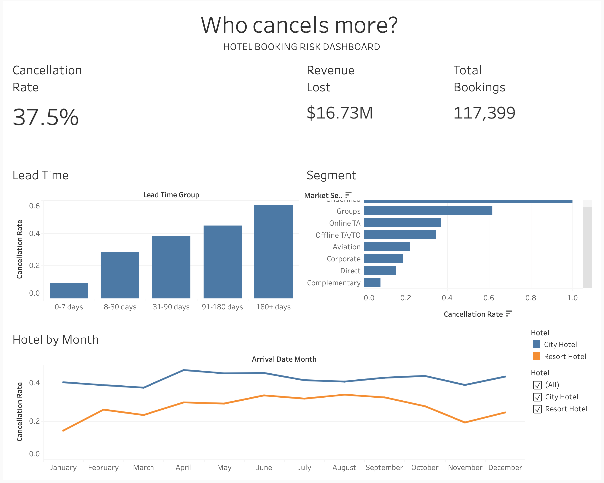

# Hotel Booking Cancellation - Analysis and Risk Segmentation

> **Who cancels more?** An end-to-end analysis of 117K hotel bookings to find which profiles drive cancellations and how much revenue is at stake.

**Interactive dashboard (Tableau Public):** [Who Cancels More? Hotel Booking Risk Dashboard](https://public.tableau.com/app/profile/maria.sanchez.gasta.adui/viz/WhoCancelsMoreHotelBookingRiskDashboard/HotelBookingCancellation-AnalysisandRiskSegmentation)

[](https://colab.research.google.com/github/msgastanadui/hotel-cancellation-analysis/blob/main/notebooks/01-data-preparation.ipynb)

   
---

## 1. Business Problem

A hospitality group operates two hotels in Portugal: a City Hotel and a Resort Hotel. Of the 117,399 bookings analyzed, **37.5% were canceled**. Each cancellation leaves a room unsold, and a late one leaves little time to resell it. The team has no clear view of which bookings are truly at risk, so the same policy is applied to all of them.

**Business question:** Which booking profiles are most likely to cancel, and what policy (deposits, cancellation fees, controlled overbooking) can reduce or recover the revenue lost without discouraging guests from booking?

**Supporting questions**
1. Which mix of lead time, segment and hotel concentrates the most cancellations?
2. Why do Non Refund bookings show a ~99% cancellation rate?
3. How much revenue is lost to cancellations?
4. What action fits each risk profile?

---

## 2. Tools

| Stage | Tool |
|---|---|
| Data preparation | Python (pandas) in Google Colab |
| Analysis | SQL (DuckDB) |
| Dashboard | Tableau Public |
| Version control | Git / GitHub |

---

## 3. Project Structure

```
hotel-cancellation-analysis/
├── data/
│   ├── raw/          # hotel_bookings.csv (not included, see Data Source)
│   └── clean/        # clean_bookings.csv (generated by notebook 01)
├── notebooks/
│   ├── 01-data-preparation.ipynb
│   └── 02-sql-analysis.ipynb
├── sql/
│   └── hotel_cancellation_queries.sql
├── dashboard/        # screenshot and link to the Tableau dashboard
├── report/           # project report and presentation
└── README.md
```

---

## 4. Data Source

**Hotel Booking Demand** dataset on [Kaggle](https://www.kaggle.com/datasets/jessemostipak/hotel-booking-demand) (Antonio, Almeida & Nunes, 2019): 119,390 reservation-level records from two hotels in Portugal, July 2015 to August 2017.

To reproduce the project, download `hotel_bookings.csv` from Kaggle and place it in `data/raw/`.

---

## 5. Data Preparation

Cleaning rules were applied on a working copy; the raw data is never modified.

| Rule | Rows removed | Rows remaining |
|---|---|---|
| Initial rows | - | 119,390 |
| Bookings with no guests | 180 | 119,210 |
| ADR <= 0 | 1,811 | 117,399 |
| Zero nights | 0 | 117,399 |

- The 715 zero-night bookings already had ADR <= 0, so the rules overlap and the last rule removes nothing new.
- Missing `children` values were set to 0 and missing `country` values to `Unknown`.
- Bookings with no guests, zero nights or ADR <= 0 were treated as **likely system errors** (reservation systems usually default to at least 1 or 2 guests). This is an assumption.
- **Duplicates were not removed**: the dataset has no booking ID, so identical rows may be different bookings.
- Features created: `total_nights`, `revenue` (ADR x total nights, i.e. potential revenue), `arrival_date`, `lead_time_group` and `booking_status`.

The cancellation rate stays at ~37.5% after cleaning (the 1.7% of rows removed does not distort the problem).

---

## 6. Key Findings

| Dimension | Finding |
|---|---|
| **Overall** | 117,399 bookings, **37.5%** canceled |
| **Hotel** | City Hotel 42.2% vs Resort Hotel 28.1% |
| **Lead time** | Cancellation rises from 9.7% (0-7 days) to 57.2% (180+ days); bookings made more than 90 days ahead account for **58.7%** of all cancellations |
| **Market segment** | Online TA accounts for 47.1% of cancellations and **61.1% of revenue lost**; Groups has the highest rate (61.7%) |
| **Customer type** | Transient customers account for 82.6% of cancellations |
| **Country** | Portugal is 40% of bookings and 62.1% of cancellations; it cancels more even without deposits (40.1% vs 23.4% elsewhere, No Deposit only) |
| **Seasonality** | City Hotel peaks in April-June (~45-47%); Resort Hotel is lowest in winter (15-19%) and highest in summer (~32-34%) |
| **Special requests** | 0 requests: 48.3% canceled vs 22.0% with 1+ (association, not causation) |
| **Previous cancellations** | A previous cancellation is a real signal: ~87% among No Deposit bookings |

### Revenue at stake

| Scenario | Assumption | Revenue lost | % of potential revenue |
|---|---|---|---|
| A | All canceled revenue is lost | ~16.7M | ~39% |
| B | Non Refund cancellations are retained revenue | ~13.1M | ~31% |

Even in the conservative scenario, close to a third of potential revenue is lost, almost all of it from **No Deposit** bookings.

---

## 7. Recommendations

These are **hypotheses to validate**, not proven solutions (the data shows where the risk is, not what would change guest behavior).

1. **Target long lead times (90+ days):** test deposits, tiered cancellation fees or pre-arrival confirmations for these bookings, which concentrate 58.7% of cancellations.
2. **Prioritize Online TA and Groups:** together they account for 74.5% of cancellations. Test stricter terms with Groups and cancellation fees or deposits with Online TA, weighing the risk of losing bookings to competitors.
3. **Use different policies per hotel and season:** City Hotel needs measures all year (strongest in spring); Resort Hotel mainly in summer.
4. **Recover revenue from the highest-risk profiles:** a higher cancellation fee can recover part of the loss whether or not the room is resold.
5. **Encourage personalization:** guests with special requests cancel far less. Inviting them to customize the stay (room, arrival time) may raise commitment.
6. **Validate with an A/B test** before rolling out any policy change.

---

## 8. Limitations and Next Steps

- **Non Refund anomaly:** these bookings show ~99% cancellation, concentrated in Portugal, Groups and Offline TA/TO. The dataset has **no payment data**, so it is unclear whether that revenue was actually retained or whether deposit type is recorded reliably (for example, the system may not distinguish what is really refundable). *Next step:* validate with the finance team how deposits are recorded and whether these cancellations were charged.
- **Pre-COVID data (2015-2017):** it may not reflect post-pandemic booking behavior.
- **Associations, not causes:** for example, special requests are usually made after booking, so they are not a predictor at booking time.
- **Seasonality caveat:** July and August have three years of data, other months only two. Compare rates, not volumes.
- **Customer type vs segment:** `customer_type = Group` is not the same as `market_segment = Groups`.
- **Next steps:** a simple explainable model (for example logistic regression) to score booking risk, and a prioritization matrix (risk vs impact) in the dashboard.

---

## 9. How to Reproduce

1. Download the dataset from Kaggle and place it in `data/raw/`.
2. Run `notebooks/01-data-preparation.ipynb` (Google Colab) to generate `data/clean/clean_bookings.csv`.
3. Run `notebooks/02-sql-analysis.ipynb`, or the queries in `sql/hotel_cancellation_queries.sql` with DuckDB.
4. Load `clean_bookings.csv` into Tableau Public to rebuild the dashboard.
